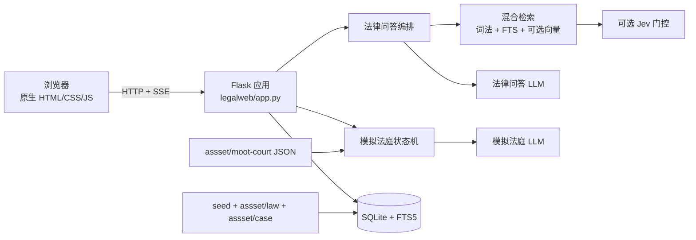
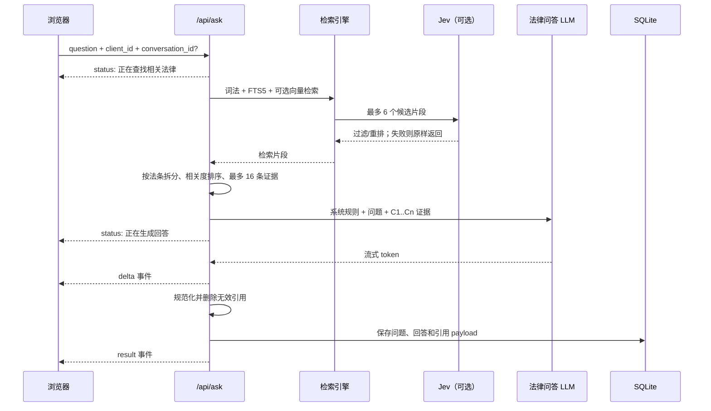

# 系统架构

## 1. 系统边界

法晓是一个单体 Flask Web 应用，内部包含两条相互独立但共用基础设施的业务链路：

- 法律问答：对本地法律资料执行混合检索，向模型提供证据，流式返回带引用的 Markdown 回答。
- 模拟法庭：由代码状态机编排庭审阶段，多个角色 Agent 依据封闭卷宗生成发言，并在检查点接收用户输入。

应用不依赖独立数据库服务。SQLite 数据库、上传文件和会话状态都保存在 `LAW_DATA_DIR`。前端资源由 Flask 同源提供，因此没有单独的前端部署和跨域配置。

## 2. 总体结构



## 3. 组件职责

| 组件 | 主要职责 | 关键约束 |
|---|---|---|
| `legalweb/app.py` | 应用工厂、路由、SSE、持久化编排、知识库缓存 | 不在路由里复制检索或庭审规则 |
| `legalweb/database.py` | SQLite schema、WAL、幂等增量迁移、事务 | 所有连接开启外键和 busy timeout |
| `legalweb/documents.py` | 文档解析、标题保留、分块、安全限制 | 支持 Markdown/TXT/DOCX，不直接 OCR PDF |
| `legalweb/rag.py` | 分词、词法打分、FTS、向量检索、RRF | 向量失败必须自动降级 |
| `legalweb/jev_gate.py` | 低相关过滤、提示注入检测 | fail-open，网络失败不得阻断问答 |
| `legalweb/qa.py` | 证据逐条化、提示词、引用白名单 | 模型不能引用本次证据之外的编号 |
| `legalweb/llm.py` | OpenAI 兼容请求、流式解析、备用提供方 | 可见 token 输出后不再切换备用模型 |
| `legalweb/courtroom/*` | 案例校验、角色约束、庭审状态机 | 卷宗封闭，流程节点由代码控制 |
| `web/app.js` | 问答、会话历史、Markdown、引用面板 | 浏览器端 `client_id` 只做匿名隔离 |
| `web/court.js` | 案例、角色、庭审事件、检查点、评议 | 必须按 SSE 事件推进界面状态 |

## 4. 法律问答数据流



### 4.1 索引阶段

1. 应用启动时遍历 `seed/`、`assset/law/`、`assset/case/`。
2. 同内容文件以 SHA-256 去重；`NOTES-*` 文件不导入。
3. `parse_document()` 读取 UTF-8 Markdown/TXT 或 DOCX。
4. `split_sections()` 默认按 1200 字分块，重叠 160 字。
5. 每个块写入 `chunks`，jieba token 写入 `chunks_fts`。
6. 配置向量服务时，同时保存归一化 embedding 和 embedding 空间指纹。

内置资料导入按 `sources.title` 幂等。标题已存在时不会重新索引，即使磁盘文件内容已经变化。维护时必须按[维护手册](maintenance.md)中的流程显式重建。

### 4.2 查询阶段

检索器并行形成三种排名：

- 词法通道：短语、中文二/三元片段和英文词匹配；最低词法分数为 0.12。
- FTS5 通道：按查询词 OR 匹配，最多读取 24 个候选。
- 向量通道：可选，余弦相似度最低 0.55；0.72 以上可直接进入候选。

三路结果使用 Reciprocal Rank Fusion 合并。没有有效向量时阈值为 0.015，有向量时为 0.02，最终最多保留 6 个检索块。向量服务不可用时自动回退到 `lexical+fts5`。

Jev 在 RRF 之后运行，默认要求相关性分数不低于 2.0、提示注入概率低于 0.5。Jev 未配置、超时、返回异常或过滤掉全部候选时，原候选继续进入回答链路。

### 4.3 证据与引用

`Evidence` 会把法条类检索块进一步拆成逐条证据，并执行：

- 清理内部来源前缀和 FBM 文件编号；
- 对重叠块中的同一法条去重；
- 保留每个命中来源的最佳条目，兼顾来源多样性；
- 再按问题相关度排序，最多向模型提供 16 条；
- 分配 `C1`、`C2` 等临时编号。

模型回答完成后，`sanitize_citations()` 只保留当前证据白名单中的引用，同时兼容 `[C1, C2]`、`【C1】` 等常见格式。前端展示 `C 编号 → 条号 → 来源 → 原文`；旧会话中的大块法条引用会在浏览器端自动拆分显示。

## 5. 模拟法庭架构

### 5.1 状态机优先

庭审阶段顺序固定为：

```text
opening
  → investigation
  → mid_review（检查点 1）
  → debate
  → poll2（检查点 2）
  → statement
  → deliberation
```

开庭、阶段转换、举证顺序、检查点和休庭由 `TrialEngine` 代码控制。模型只生成角色发言、阶段纪要和最终复盘，不能改变庭审程序。

### 5.2 用户角色

可选角色为 `juror`、`prosecutor`、`defender`、`defendant`：

- 旁听观众：完整观看庭审，中途不产生用户检查点，庭审结束后进行裁判预测。
- 人民陪审员：两次提交阶段性预判，第一次可以向公诉人、辩护人或被告人提问。
- 公诉人、辩护人、被告人：在两个关键节点从预设意见或自定义内容中完成发言。
- 前端暂停：暂停 SSE 事件消费与画面推进，保留中央发言内容；恢复后继续处理已到达的事件。
- 公诉人、辩护人、被告人：在调查后和辩论后分别提交一次 10–500 字角色发言。
- 所有角色最后都要完成裁判预测/评议，再与案例真实判决对照。

检查点出现时，引擎把庭审记录、摘要、预判、用户发问、用户发言、下一阶段保存到 `court_sessions.state`。`/continue` 从该状态恢复；模型失败时回滚到检查点，允许用户无重复记录地重试。

### 5.3 封闭卷宗约束

Agent 只获得：

- 案件事实摘要；
- 编号卷宗证据 `E1`、`E2`……；
- 案例 JSON 中的法条原文；
- 已发生的庭审记录和书记员摘要；
- 当前回合任务。

角色提示词明确禁止编造卷宗外事实或引用未提供法条。审判长程序性台词使用代码模板。角色发言采用非流式模型调用，成功后按中文标点切分为 SSE `delta`，获得稳定的打字效果并避免暴露思考内容。

## 6. 持久化模型

SQLite 默认文件为 `.law-data/law.sqlite3`，生产环境为 `/data/law.sqlite3`。

| 表 | 用途 | 关键字段 |
|---|---|---|
| `sources` | 知识库资料 | 唯一 `title`、原文件名、块数 |
| `chunks` | 检索分块 | `section`、正文、embedding、空间指纹 |
| `chunks_fts` | FTS5 虚拟表 | 与 `chunks.id` 共用 rowid |
| `conversations` | 问答会话 | `owner_id` 为浏览器匿名标识 |
| `messages` | 问答消息 | 正文及 JSON payload（引用、notice、backend） |
| `court_sessions` | 庭审状态 | transcript、state、deliberation、analysis |

数据库启用 WAL、外键和 30 秒 busy timeout。当前生产命令使用单 Gunicorn worker、8 threads；这样既保留并发请求能力，也避免多 worker 各自持有知识库内存缓存并放大 SQLite 写竞争。

## 7. 前端结构

- `index.html` 包含法律问答和模拟法庭两个 tab 的静态结构。
- `app.js` 管理问答 SSE、Markdown 渲染、会话历史、引用栏和匿名 `client_id`。
- `court.js` 管理案例加载、角色选择、庭审 SSE、检查点表单和评议。
- `styles.css` 使用单一响应式样式表；法律问答是固定应用壳，只有消息区滚动，引用默认折叠到右侧。

前端没有打包器、框架或 npm 依赖。修改资源后刷新即可验证，但生产环境可能受浏览器缓存影响，部署验证时应使用无痕窗口或强制刷新。

## 8. 信任与安全边界

- `client_id` 是保存在 localStorage 的匿名随机值，只用于避免不同浏览器互相看到对话；它不是身份认证或访问控制凭证。
- 当前知识库上传 API 没有登录保护。公开生产环境如需开放上传，必须先增加管理员鉴权、速率限制和审计。
- LLM、向量和 Jev 密钥只能存在于服务器环境变量。
- 模型输出在前端经过转义和受限 Markdown 渲染；不要改为直接插入未清理 HTML。
- 法律问答和模拟法庭都是普法/教育工具，不应被扩展成自动作出个案法律决定的系统。
