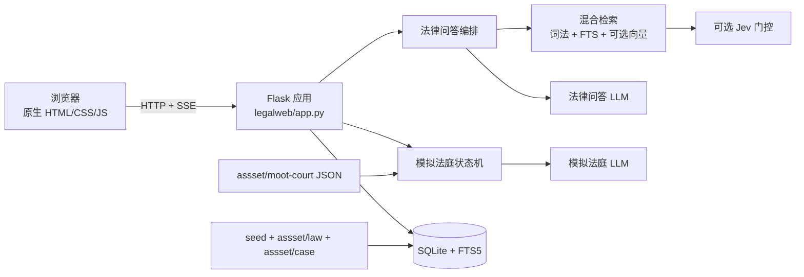
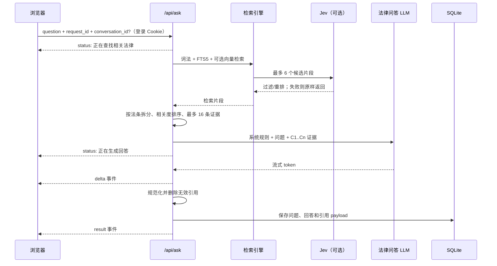

# 系统架构

## 1. 系统边界

法晓是一个单体 Flask Web 应用，内部包含三条相互独立但共用基础设施的业务链路：

- 法律问答：对本地法律资料执行混合检索，向模型提供证据，流式返回带引用的 Markdown 回答。
- 法律问题工作台：结构化采集案情（发生了什么、当事人关系、金额、证据、诉求、期限风险），检索现行法条后生成事项档案：问题归类、事实摘要、适用依据、缺少信息、证据清单、行动清单、风险提醒，并推荐可练手的模拟庭审。
- 模拟法庭：由代码状态机编排庭审阶段，多个角色 Agent 依据封闭卷宗生成发言，并在检查点接收用户输入。

应用不依赖独立数据库服务。SQLite 数据库、上传文件和会话状态都保存在 `LAW_DATA_DIR`。前端资源由 Flask 同源提供，因此没有单独的前端部署和跨域配置。

## 2. 总体结构



## 3. 组件职责

| 组件 | 主要职责 | 关键约束 |
|---|---|---|
| `legalweb/app.py` | 应用工厂、路由、SSE、持久化编排、知识库缓存、账户/反馈/埋点 | 不在路由里复制检索或庭审规则 |
| `legalweb/database.py` | SQLite schema、WAL、幂等增量迁移、事务 | 所有连接开启外键和 busy timeout |
| `legalweb/documents.py` | 文档解析、标题保留、分块、安全限制 | 支持 Markdown/TXT/DOCX，不直接 OCR PDF |
| `legalweb/rag.py` | 分词、词法打分、FTS、向量检索、RRF | 向量失败必须自动降级 |
| `legalweb/jev_gate.py` | 低相关过滤、提示注入检测 | fail-open，网络失败不得阻断问答 |
| `legalweb/qa.py` | 证据逐条化、提示词、引用白名单 | 模型不能引用本次证据之外的编号 |
| `legalweb/source_meta.py` | 解析法条文件头著录信息（时效性/公布/施行/机关），归一为引用效力标识 | 解析不到的来源显式标注「未确认」，不猜测效力 |
| `legalweb/matter.py` | 问题工作台：案情采集校验、结构化报告提示词与解析、推荐庭审匹配 | `applicable_laws` 只能来自检索白名单；JSON 解析失败即失败重试 |
| `legalweb/llm.py` | OpenAI 兼容请求、流式解析、备用提供方 | 可见 token 输出后不再切换备用模型 |
| `legalweb/pkulaw.py` | 北大法宝 MCP 在线法条检索（可选） | 未配置或失败一律降级为空列表 |
| `legalweb/courtroom/*` | 案例校验、角色约束、庭审状态机 | 卷宗封闭，流程节点由代码控制 |
| `legalweb/courtroom/scoring.py` | 评议说理评分（证据判断/程序理解/说理完整性，0-10） | 附加体验：解析失败静默跳过，不影响判决对照主链路 |
| `web/app.js` | 问答、会话历史（重命名/置顶/导出）、Markdown、引用面板、反馈条、埋点、账户面板、登录弹窗 | 浏览器端 `client_id` 仅用于匿名期数据并入账户 |
| `web/matter.js` | 问题工作台：案情采集表单、事项档案渲染、推荐庭审跳转 | 报告字段全部 textContent 渲染，不插入未清理 HTML |
| `web/court.js` | 案例、角色、庭审事件、检查点、评议、复盘 | 必须按 SSE 事件推进界面状态 |

## 4. 法律问答数据流



### 4.1 索引阶段

1. 应用启动时遍历 `seed/`、`assset/law/`、`assset/case/`。
2. 同内容文件以 SHA-256 去重；`NOTES-*` 文件不导入。
3. `parse_document()` 读取 UTF-8 Markdown/TXT 或 DOCX。
4. `split_sections()` 默认按 1200 字分块，重叠 160 字。
5. 每个块写入 `chunks`，jieba token 写入 `chunks_fts`。
6. 配置向量服务时，同时保存归一化 embedding 和 embedding 空间指纹。

内置资料导入按 `sources.title` 幂等。标题已存在时不会重新索引，即使磁盘文件内容已经变化。维护时必须按[维护手册](maintenance.md)中的流程显式重建。

### 4.2 查询阶段

检索器并行形成三种排名：

- 词法通道：短语、中文二/三元片段和英文词匹配；最低词法分数为 0.12。
- FTS5 通道：按查询词 OR 匹配，最多读取 24 个候选。
- 向量通道：可选，余弦相似度最低 0.55；0.72 以上可直接进入候选。

三路结果使用 Reciprocal Rank Fusion 合并。没有有效向量时阈值为 0.015，有向量时为 0.02，最终最多保留 6 个检索块。向量服务不可用时自动回退到 `lexical+fts5`。

Jev 在 RRF 之后运行，默认要求相关性分数不低于 2.0、提示注入概率低于 0.5。Jev 未配置、超时、返回异常或过滤掉全部候选时，原候选继续进入回答链路。

### 4.3 证据与引用

`Evidence` 会把法条类检索块进一步拆成逐条证据，并执行：

- 清理内部来源前缀和 FBM 文件编号；
- 对重叠块中的同一法条去重；
- 保留每个命中来源的最佳条目，兼顾来源多样性；
- 再按问题相关度排序，最多向模型提供 16 条；
- 分配 `C1`、`C2` 等临时编号。

模型回答完成后，`sanitize_citations()` 只保留当前证据白名单中的引用，同时兼容 `[C1, C2]`、`【C1】` 等常见格式。前端展示 `C 编号 → 条号 → 来源 → 效力标识 → 原文`；旧会话中的大块法条引用会在浏览器端自动拆分显示。

### 4.4 来源效力标识

`source_meta.py` 在索引时解析法条文件头部的北大法宝著录信息（时效性、公布日期、施行日期、制定机关、发文字号），存入 `sources.meta`；旧库由 `backfill_source_meta()` 用每个来源的首个分块幂等补录。个别无著录头的内置法条（如《刑法（2023 修正）》）在 `BUILTIN_META` 中按展示标题补录。引用与 `/api/kb` 随下发一化的 `validity` 结构（`current`/`amended`/`repealed`/`unknown`）；北大法宝在线条目按其 `timeliness` 字段走同一套归一化。解析不到任何信息的来源展示「未确认」，不猜测效力。

## 5. 模拟法庭架构

### 5.1 状态机优先

庭审阶段顺序固定为：

```text
opening
  → investigation
  → mid_review（检查点 1）
  → debate
  → poll2（检查点 2）
  → statement
  → deliberation
```

开庭、阶段转换、举证顺序、检查点和休庭由 `TrialEngine` 代码控制。模型只生成角色发言、阶段纪要和最终复盘，不能改变庭审程序。

### 5.2 用户角色

可选角色为 `juror`、`prosecutor`、`defender`、`defendant`：

- 旁听观众：完整观看庭审，中途不产生用户检查点，庭审结束后进行裁判预测。
- 人民陪审员：两次提交阶段性预判，第一次可以向公诉人、辩护人或被告人提问。
- 公诉人、辩护人、被告人：在两个关键节点从预设意见或自定义内容中完成发言。
- 前端暂停：暂停 SSE 事件消费与画面推进，保留中央发言内容；恢复后继续处理已到达的事件。
- 公诉人、辩护人、被告人：在调查后和辩论后分别提交一次 10–500 字角色发言。
- 所有角色最后都要完成裁判预测/评议，再与案例真实判决对照。

检查点出现时，引擎把庭审记录、摘要、预判、用户发问、用户发言、下一阶段保存到 `court_sessions.state`。`/continue` 从该状态恢复；模型失败时回滚到检查点，允许用户无重复记录地重试。

### 5.3 封闭卷宗约束

Agent 只获得：

- 案件事实摘要；
- 编号卷宗证据 `E1`、`E2`……；
- 案例 JSON 中的法条原文；
- 已发生的庭审记录和书记员摘要；
- 当前回合任务。

角色提示词明确禁止编造卷宗外事实或引用未提供法条。审判长程序性台词使用代码模板。角色发言采用非流式模型调用，成功后按中文标点切分为 SSE `delta`，获得稳定的打字效果并避免暴露思考内容。

## 5.4 知识复习与宠物掌握模型

- 庭审评议的 `verdict` SSE 事件与复盘接口都会附带本案卷宗法条（`knowledge` 数组），前端渲染复习卡片。
- 用户把每条法条标记为「已掌握 / 待复习」，落库 `knowledge_points`，按 `(账户, 条文标识)` 去重；再次点击当前状态可清除标记。
- 獬豸奖励在问答（+2）、庭审（+10）之外新增「掌握知识点」（+6）：仅在**首次**把某条文标记为已掌握时发放，奖励事件按 `knowledge:<条文标识>` 去重；改判状态、清除后重标都不重复发经验。
- 宠物状态（`/api/pet`）的 `knowledge` 字段聚合已掌握/待复习计数，是学习导航角色的数据基础。

### 5.5 问答→庭审直连与说理评分

- `POST /api/court/suggest` 复用工作台的关键词匹配（`matter.CASE_MATCH_KEYWORDS`）把任意问题文本映射到内置案例（最多 2 个）；问答回答完成后前端异步请求并在消息尾部渲染"去练手"入口，命中即跳转模拟法庭。
- 评议可附 20-800 字说理（`reasoning`）：判决下发后由 `courtroom/scoring.py` 对照真实判决与卷宗，按证据判断、程序理解、说理完整性三维度评分（各 0-10，钳制），随 SSE `reasoning_score` 事件下发、存入 `court_sessions.reasoning_score` 并在复盘接口回放。评分是附加体验：模型异常或输出无法解析时静默跳过，判决对照、复盘与庭审奖励不受影响。

## 6. 持久化模型

SQLite 默认文件为 `.law-data/law.sqlite3`，生产环境为 `/data/law.sqlite3`。

| 表 | 用途 | 关键字段 |
|---|---|---|
| `sources` | 知识库资料 | 唯一 `title`、原文件名、块数、`meta`（效力元数据 JSON） |
| `chunks` | 检索分块 | `section`、正文、embedding、空间指纹 |
| `chunks_fts` | FTS5 虚拟表 | 与 `chunks.id` 共用 rowid |
| `users` | 账户 | 唯一用户名（大小写不敏感）、密码哈希、`is_admin` |
| `auth_sessions` | 会话令牌 | 不透明 token、过期时间（登录后 30 天） |
| `conversations` | 问答会话 | `owner_id` 为 `u:<user_id>` 账户身份键；`pinned` 置顶排序 |
| `messages` | 问答消息 | 正文及 JSON payload（引用、notice、backend） |
| `matters` | 问题工作台事项档案 | `intake` 采集 JSON、`result` 报告 JSON、`status` 三态 |
| `answer_feedback` | 回答反馈 | `(user_id, message_id)` 唯一，`rating`/`reason`/`comment` |
| `events` | 产品事件埋点 | 白名单事件名、裁剪后的 props、账户 |
| `court_sessions` | 庭审状态 | transcript、state、deliberation、analysis、`owner_id` |
| `knowledge_points` | 知识复习 | `(owner_id, article_ref)` 唯一；`status` 为已掌握/待复习 |
| `pet_progress` / `pet_memories` / `pet_reward_events` | 獬豸成长、记忆与奖励事件 | 均以账户身份键（`client_id`）隔离，奖励按事件 ID 去重 |
| `settings` | 检索增强开关 | key/value |

数据库启用 WAL、外键和 30 秒 busy timeout。当前生产命令使用单 Gunicorn worker、8 threads；这样既保留并发请求能力，也避免多 worker 各自持有知识库内存缓存并放大 SQLite 写竞争。

## 7. 前端结构

- `index.html` 包含法律问答、问题工作台和模拟法庭三个 tab 的静态结构，以及登录/账户两个对话框。
- `app.js` 管理问答 SSE、Markdown 渲染、会话历史（重命名/置顶/导出 Markdown）、引用栏（含效力标识）、回答反馈条、产品埋点（`window.trackEvent`，批量静默上报）、登录/账户对话框（焦点锁定与恢复）和匿名 `client_id`。
- `matter.js` 管理问题工作台：采集表单、SSE 进度、事项档案卡片渲染（归类/依据/行动/证据/风险/推荐庭审）与事项列表；通过 `window.courtOpenCase` 跳转模拟法庭。
- `learn.js` 管理学习地图：总览统计、主题卡片（知识点状态、案例轨道完成度）与行动入口（去练手/回看复盘/提问/整理事项）。
- `court.js` 管理案例加载、角色选择、庭审 SSE、检查点表单、评议（量刑滑块带可访问名称）、复盘，以及判决/复盘页的知识复习卡片（标记已掌握/待复习，联动獬豸奖励）；通过 `window.trackEvent` 上报庭审漏斗事件。
- `styles.css` 使用单一响应式样式表；法律问答是固定应用壳，只有消息区滚动，引用默认折叠到右侧。

前端没有打包器、框架或 npm 依赖。修改资源后刷新即可验证，但生产环境可能受浏览器缓存影响，部署验证时应使用无痕窗口或强制刷新。

## 8. 信任与安全边界

- 账户体系：注册/登录颁发不透明会话令牌 Cookie（30 天，落库）；业务写入接口（问答、会话、宠物、反馈、埋点）全部要求登录，数据按 `u:<user_id>` 身份键隔离。注册/登录/改密/注销按 IP 限流（300 秒 30 次）。
- 管理员边界：首个注册用户自动成为管理员。知识库上传、检索增强开关、运行日志、回答反馈与事件统计仅管理员可用。
- `client_id` 是保存在 localStorage 的匿名随机值，仅用于登录/注册时把匿名期数据并入账户；它不是身份认证或访问控制凭证。
- 回答反馈与产品埋点：反馈按 `(user, message)` 去重且只能评价自己会话里的回答；埋点只收白名单事件与短属性，不收集问题内容。
- 注销账号需密码二次确认并删除全部名下数据；最后一名管理员不允许注销。
- LLM、向量、Jev 和北大法宝密钥只能存在于服务器环境变量。
- 模型输出在前端经过转义和受限 Markdown 渲染；不要改为直接插入未清理 HTML。
- 法律问答和模拟法庭都是普法/教育工具，不应被扩展成自动作出个案法律决定的系统；无有效依据时回答必须明示，不编造条文。
